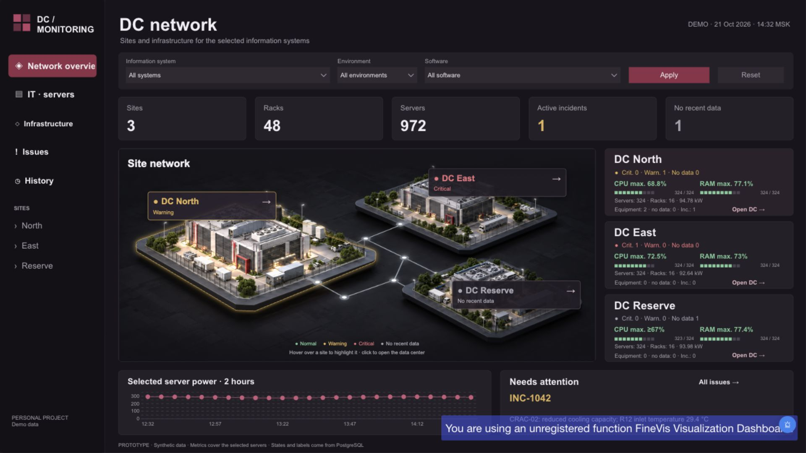
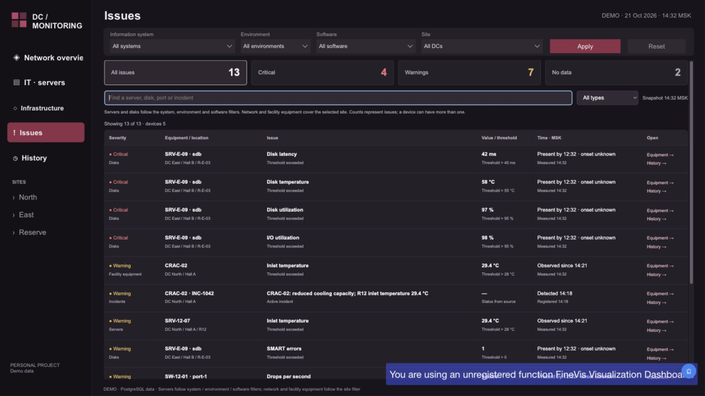

# DC Monitoring

A five-page data-center monitoring demonstration for FineReport / FineVIS, backed by a reproducible PostgreSQL database. Explore physical infrastructure, business-system placement, server and switch telemetry, an issue queue, and component history.

This is a **synthetic, fixed snapshot at 2026-10-21 14:32 Europe/Moscow (11:32 UTC)**. Reloading the dashboard does not collect new measurements. The full inventory contains **3 sites, 6 halls, 48 racks, 972 servers, 96 switches and 1,944 drives**. The unfiltered queue contains **13 issues: 4 critical, 7 warning and 2 unknown**, affecting **5 devices**, including **1 active incident**. An issue is not a device or an incident count.





The screenshots retain the vendor's runtime banner. Generic equipment illustrations are decorative; database rows supply placement, occupancy, labels, health and measurements.

## Start here

1. Follow [installation](docs/installation.md) to create a new PostgreSQL database, restore the fixture and configure a separate read-only report account.
2. Install your own FineReport / FineVIS runtime and configure its named PostgreSQL connection **`DC_MONITORING`**. Vendor binaries and licenses are not included.
3. Install the report and browser assets into an explicitly selected FineReport webroot, then open the report under the **`/webroot`** context.
4. Use the [demo walkthrough](docs/demo-walkthrough.md) and [five-page user guide](docs/user-guide.md).

The existing local demonstration uses **FineVIS v11 4.13.0**. The report records older plugin metadata `com.fr.plugin.wysiwyg.v11` version **3.4.1**; this is template provenance, not a minimum compatibility guarantee. No exact FineReport patch compatibility is claimed. The supported local database baseline is PostgreSQL 16; Python 3.9+ runs the standard-library scripts; Node.js 22+ runs the package-free JavaScript tests (validated locally with Node.js 24). Docker Compose is optional and hosts PostgreSQL only.

After configuring exported libpq connection variables and password-file authentication as described in installation, the core commands are:

```sh
python3 scripts/database.py init
python3 scripts/verify_database.py --require-sequences
make test
make audit
```

Initialization requires an existing destination database and refuses an existing `dcmon` schema. It commits schema, fixture and descriptions in one transaction. It never resets a database.

## What is included

| Path | Purpose |
|---|---|
| [database](database) | Schema, compressed deterministic synthetic fixture, English SQL metadata and machine-readable catalog |
| [dashboard/report/Infrastructure_Overview.fvs](dashboard/report/Infrastructure_Overview.fvs) | Portable five-page FineVIS report using a named connection only |
| [dashboard/tools](dashboard/tools) | Readable query builders and English display localization |
| [dashboard/sql](dashboard/sql) | All 22 generated dataset queries |
| [dashboard/scene](dashboard/scene) | Native browser modules, HTML/CSS, tests and illustration assets |
| [scripts](scripts) | Safe restore, verification, report refresh, explicit installation, audit and release packaging |
| [tests](tests) | Installer safety regression tests |

## Read further

- [Architecture and data flow](docs/architecture.md)
- [Data model](docs/data-model.md) and [complete data dictionary](docs/data-dictionary.md)
- [All 22 dataset contracts](docs/dataset-contract.md)
- [Metric units, freshness and health rules](docs/metrics-and-status.md)
- [Development](docs/development.md), [validation evidence](docs/validation.md), [troubleshooting](docs/troubleshooting.md) and [release preparation](docs/release.md)
- [Contributing](CONTRIBUTING.md), [security](SECURITY.md), [change history](CHANGELOG.md) and [third-party notices](THIRD_PARTY_NOTICES.md)

Project code is [MIT licensed](LICENSE). Proprietary FineReport / FineVIS components remain subject to their vendor terms and must be installed separately. [Asset provenance](dashboard/scene/assets/README.md) distinguishes generated illustrations and retained runtime screenshots from project code. This repository supplies no vendor runtime, licensing workaround or production ingestion service. GitHub Pages can display documentation or an isolated static illustration, but cannot run the full database-backed FineVIS dashboard.
