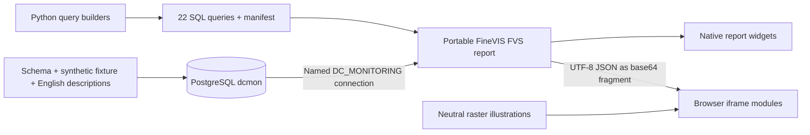

# Architecture

PostgreSQL owns identity, temporal topology, telemetry validity and incident scope. FineVIS executes 22 named read-only queries and renders five report pages. Browser iframes render the physical hierarchy, issue queue and history from the query results; they never connect directly to PostgreSQL.

## Reproducible source chain

`database/001_schema.sql` defines objects and constraints; `002_demo_data.sql.gz` supplies ordered synthetic rows; `003_comments.sql` adds English metadata. [The catalog](../database/catalog.json) records object descriptions, columns and fixture counts. The [data model](data-model.md) explains effective placement, execution paths, dependencies and source-specific telemetry selection; the [dictionary](data-dictionary.md) defines every exposed column.

`dashboard/tools/build_queries.py` owns the shared filter pipeline and IT projections. `network_queries.py`, `scene_queries.py` and `operations_queries.py` register their projections. `english_locale.py` applies display-only translations. Building writes `dashboard/sql/*.sql` and `dashboard/datasets.json`; it neither connects to a database nor deploys a report.

`scripts/refresh_report.py` replaces only named dataset queries in the FVS ZIP, validates the exact dataset/parameter set and `DC_MONITORING` connection, preserves widget IDs, events, chart files and assets, and writes `dashboard/datasets.xml` for separate dataset import. Its default report output is `build/Infrastructure_Overview.fvs`; `make build` explicitly updates the checked-in report. ZIP timestamps are fixed for reproducibility.

## Runtime boundaries

The FVS is a report definition, not a self-contained application server. FineReport/FineVIS, a PostgreSQL JDBC driver and vendor licensing must be installed separately. There is no packaged vendor runtime and no replacement engine.

FineVIS uses standard widgets on the DC network and IT pages and same-origin iframe URLs under `/webroot/DC_MONITORING_3D/`. `index.html` / `app.mjs` render Infrastructure and the compact overview. `operations.html` / `operations.mjs` render Issues and History. FineVIS supplies base64 UTF-8 JSON in the iframe fragment. Base64 is transport encoding, not encryption; users who can view a report can inspect its payload. Query strings carry numeric selection/filter IDs, never database passwords.

Browser modules divide responsibilities as follows:

| Modules | Responsibility |
|---|---|
| `core.mjs` | Decode/validate payload, identity maps, hierarchy and navigation URLs |
| `scope.mjs`, `metrics.mjs` | Scope aggregation, metric validity, severity and null-preserving history |
| `navigation.mjs`, `layout.mjs` | Deterministic selection, rack placement and equipment layout |
| `campus.mjs`, `illustration.mjs` | Physical overview and neutral illustration overlays |
| `metric-widgets.mjs`, `hardware-widgets.mjs`, `hardware.mjs` | Gauges, trends, disk/port presentation and equipment health |
| `app.mjs` | Infrastructure DOM and report navigation |
| `operations-core.mjs`, `operations.mjs` | Queue filtering, deep links and bounded history charts |

The deployment script changes module filenames/imports to `.js` for the vendor server's MIME behavior. Source and tests remain `.mjs`. The `DC_MONITORING_3D` name is a compatibility URL; no WebGL library or obsolete 3D engine is required.

## Scope is intentionally asymmetric

System, environment and software filters intersect application execution paths to select physical servers. With all systems and environments selected, unmapped compute paths are included. A software match on an unrelated sibling VM does not qualify a path. Site selection checks effective device placement at the snapshot time.

The physical scene retains the complete sites/rooms/racks/devices inventory so occupancy and support equipment stay truthful while filtered server telemetry changes. On Issues and History, servers follow the application filters; network and facility equipment follow the selected site. Network site cards also retain configured sites with zero matching servers. These choices prevent a software filter from making a real rack, switch or cooling device disappear. They also mean totals from different pages must be compared at the documented grain.

## Time and health

The report SQL fixes its reference instant at `2026-10-21 14:32:00+03`. Effective intervals use `[valid_from, valid_to)`, observations must be at or before the reference time, and incident state uses the latest eligible event. The UI is a fixed demonstration, not a streaming collector.

State observations, metric thresholds, missing-data classifications and incident severity remain separate inputs. Unusable telemetry stays NULL; no chart fills missing samples with zero. Site power is shown only with complete selected-server coverage. Issue rows represent individual problematic series, fallback device states and unique active incidents. See [metrics and status](metrics-and-status.md) and [dataset contracts](dataset-contract.md) for their exact differences.

## Installation and publication boundaries

Database initialization is atomic and refuses an occupied `dcmon` namespace. The report installer requires an explicit webroot and owns two DC targets only. Replacement is opt-in and backed up. Neither tool alters another dashboard or vendor license files.

The audit examines the public allowlist, Markdown links, forbidden local/secret artifacts, compressed SQL and embedded FVS connection definitions. Packaging snapshots the audited bytes into a deterministic ZIP with checksums; it makes no network request. GitHub Pages cannot execute PostgreSQL or the FineVIS engine, so hosting the source there does not host the full dashboard.
