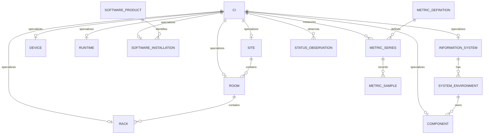

# Data model

The `dcmon` schema separates stable inventory identity, effective-dated relationships, observed telemetry and incident history. The fixture is entirely synthetic and contains 972 physical servers across three sites, six rooms and 48 racks. It preserves the existing demonstration's IDs, topology, numeric values and timestamps. English display text is translated; software, system, device and metric codes remain stable.

The reproducible presentation time is **2026-10-21 14:32:00 Europe/Moscow**, equivalent to **2026-10-21 11:32:00 UTC**. The database remains queryable at other times, but freshness and effective placement will change the results. Use an explicit timestamp instead of `now()` when reproducing the walkthrough.

The [data dictionary](data-dictionary.md) lists every column and integrity rule. [`database/catalog.json`](../database/catalog.json) provides the same object inventory for automated verification. The executable source is [`001_schema.sql`](../database/001_schema.sql), followed by the deterministic synthetic fixture and English metadata script.

## Identity and inventory

`ci` is the central configuration-item identity. A CI has an immutable `kind`, a stable `ci_key`, ownership and a lifecycle (`planned`, `active`, `retired`). A hostname or display-name change does not establish a new identity. Retired objects remain in inventory so historical references still resolve. A recreated pod or container must receive a new identity even when its name is reused.

Each typed inventory row references one CI: `site`, `room`, `rack`, `device`, `runtime`, `cluster`, `software_installation`, `information_system`, `component` and `storage_volume`. Triggers require the expected CI kind; a foreign key alone cannot enforce this. `device_class` and `runtime_kind` are immutable for the same reason. The reverse requirement, that every CI must already have a subtype row, is not enforced: ingesting a base identity and its subtype are distinct operations.

`external_identity` maps each source-specific identifier to a stable CI. `source_system` describes authoritative integrations using non-secret configuration references. `team` contains synthetic service-group references; neither is a credential store. `ingestion_run` records processing outcomes and cursor watermarks, with accepted/rejected counts and sanitized diagnostics. An ingestion success does not imply that every source observation is fresh.

This diagram shows selected identity and catalog relationships. Effective placement, graph links and incident associations below are separate relations; rack membership is never inferred from a display name.

## Physical and logical topology

`site → room → rack` is the physical navigation hierarchy. `device_placement` records a device's room, optional rack and occupied rack-unit interval. Floor equipment has no rack; 0U rack equipment has no U interval. For a rack interval, `u_start` is one-based and the inclusive top unit is `u_start + u_height - 1`. Capacity checks lock the rack while validating placement. Exclusion constraints prevent two simultaneous placements for a device and conflicting rack space. Rack shrinking checks **all placement history**, including closed intervals, so an edit cannot invalidate past physical layouts.

`network_port` belongs to a physical device and records nominal speed rather than measured traffic. `network_link` connects two ports with canonical endpoint ordering (`port_a_id < port_b_id`). Effective-dated exclusions prevent concurrent cables on a port. `storage_volume` belongs to a device of class `storage`; `volume_attachment` records volume-to-compute attachment and a mount reference. Capacity is allocated GiB, not used space. `cluster_member` records effective membership without asserting physical co-location or application ownership.

`hosting` models VM → physical server, pod → VM/server and container → pod. `installation_placement` places a software installation on compute. `deployment` places a business component on compute or a software installation. Typed triggers reject invalid endpoints; self-reference checks and graph cycle guards provide separate protections. Relationships express placement and dependency, not a guarantee of service health.

`scene_object` preserves optional legacy presentation coordinates and relative asset references. It is not required for current dashboard queries and does not introduce a 3D runtime dependency.

## Time and historical scope

Every relationship with `valid_from` and `valid_to` uses a half-open range **[start, end)**. The start is included; the end is excluded; NULL end is unbounded. At an exact migration boundary the old relationship stops and its replacement begins without overlap. A non-NULL end must be strictly later than the start. PostgreSQL range exclusions, supported by `btree_gist`, enforce concurrent-placement rules at the database boundary.

The model deliberately distinguishes several clocks:

| Clock | Meaning |
|---|---|
| `first_seen_at`, `retired_at` | Identity visibility; a retired object remains stored |
| `valid_from`, `valid_to` | Business-time validity of a relationship |
| `observed_at` | Time a telemetry or status fact was observed |
| `ingested_at` | Time metric telemetry reached the warehouse |
| `occurred_at` | Incident workflow event time |
| `linked_at` | Time an incident-to-CI association was established |
| `last_seen_at` | Latest source confirmation of identity, not health |

As-of functions select facts observed no later than the requested time. They do **not** apply an `ingested_at <= p_at` condition, so these are observation-time reconstructions rather than a bitemporal reconstruction of what the warehouse knew then. Software version, labels, product metadata, names, ownership and source configuration are current inventory attributes; historical topology does not reconstruct old values of those attributes.

Lifecycle filtering is function-specific and is preserved from the deployed demonstration. `compute_paths` excludes planned origins and respects origin first-seen/retirement bounds. `status_snapshot` respects first-seen/retirement but includes planned CIs. `execution_paths` uses relationship validity without independently filtering every node's lifecycle. `metric_snapshot` returns every defined series, even if a CI was not yet visible at the requested time. Consult the exact function contract before combining these results.

## Business-system execution and filters

`information_system` holds the business-system catalog and illustrative recovery targets. A system has `PROD`, `TEST` and/or `DEV` rows in `system_environment`; components belong to a particular environment. A software product is a technology catalog entry and is distinct from a business system. A concrete `software_installation` identifies an installed instance and version.

`execution_paths(p_at)` traverses component deployment, directed application dependencies, software placement and guest-to-host hosting until it reaches a physical server. Each result preserves its ordered node list. A visited-node guard prevents cycles, and a 64-node limit bounds recursion. Multiple valid routes can yield multiple paths to a server; callers must choose the appropriate grain before counting.

`compute_paths(p_at)` also starts at unmapped compute and software, including one-node server paths. `system_hosts(...)` combines those paths only when both system and environment filters are unrestricted, then deduplicates physical servers. A software filter must match an installation on the selected path or on a host node belonging to that path. Software on an unrelated sibling VM does not qualify the server. Optional rack, room and site labels come from effective physical placement; an unplaced server remains present with NULL location.

`system_software(...)` distinguishes `explicit_dependency`, when the installation itself is a path node, from `installed_on_execution_path`, when it is present on a host node. The latter describes presence and does not prove use by that application. This function does not add unmapped compute. Optional text filters use SQL NULL for unrestricted selection; empty text is a literal filter.

`v_inventory_summary` counts current `active` inventory by kind. `v_unmapped_compute` exposes active physical servers and runtimes without an execution-path association using the view's current-time query; it excludes software installations. These convenience views have no timestamp parameter and should not be treated as frozen historical extracts.

## Infrastructure dependency scope and incidents

`dependency` is directed **consumer → provider**. Its allowed endpoint combinations are:

| Type | Consumer | Provider |
|---|---|---|
| `application` | component | component or software installation |
| `power` | device or rack | PDU, UPS or generator |
| `cooling` | room, rack or device | CRAC or chiller |
| `network` | device or runtime | switch |
| `storage` | device or runtime | storage device |

`system_scope(...)` seeds execution nodes, matching system/components and their effective locations, software, volumes and clusters. It then follows non-application dependencies toward infrastructure providers. UNION deduplicates nodes and terminates cycles. It never expands reverse hosting into unrelated VMs. Attachment/location expansion uses the initial core set rather than every later provider; this is a scoped lookup, not unrestricted graph closure. With no system or environment filter, historically visible CIs also seed the scope.

`incident` holds identity, severity, detection and response deadline. `incident_event` holds workflow history; the latest event not after `p_at` defines the as-of state. `incident_ci` records `cause`, `affected` or `at_risk` links. `system_incidents(...)` includes links established by the requested time and excludes incidents whose latest state is `resolved` or `closed`. It emits one row per incident with a distinct matched-object count. Several linked devices must not multiply the incident count.

All three impact-role values can match scope. A dependency, stale reading or `at_risk` incident does not prove an application outage. Incident severity, technical CI state, inventory lifecycle and business criticality remain separate dimensions. `maintenance_window` describes planned work; maintenance is not an unplanned incident. Redundancy-group labels do not calculate resilience or availability by themselves.

## Telemetry, quality and freshness

`metric_definition` declares a stable code, unit, value type, validity bounds and illustrative warning/critical thresholds. `metric_series` identifies one CI, definition and JSON label set, selects its authoritative source, and declares collection/freshness budgets. The unique logical series identity prevents duplicate CI/metric/label streams; labels are an object, not an unstructured payload. Source selection is explicit rather than an automatic merge of competing observations.

`metric_sample` has one row per `(series_id, observed_at)`, separating observation from ingestion. A duplicate timestamp cannot coexist in one series. `quality='ok'` requires a finite non-NULL numeric value inside any configured validity bounds. `missing` and `error` require NULL. Validity bounds reject impossible values; warning/critical thresholds guide presentation and never reject otherwise valid measurements. The database does not enforce ingestion-time ordering against observation time.

`metric_snapshot(p_at)` selects the latest eligible observation per series. `raw_value` and the original timestamp remain for diagnostics; `display_value` is populated only for good-quality data whose age is within its freshness budget. The order of classification matters:

| Condition | `freshness` | `display_value` |
|---|---|---|
| No observation at/before `p_at` | `missing` | NULL |
| Age strictly greater than `stale_after_sec` | `stale` | NULL |
| Within budget, quality `missing` or `error` | original quality | NULL |
| Within budget, quality `ok` | `fresh` | numeric reading |

At exactly the freshness budget the reading remains fresh. A stale missing/error point is classified as `stale`; no fallback to an older good point occurs. Missing/error/stale values must not be averaged as zeros or colored healthy. Age is seconds relative to observation time; no future sample is selected.

`status_observation` independently records technical states `healthy`, `warning`, `critical`, `unknown` and `maintenance`, with a per-point validity lifetime. `status_snapshot(p_at)` returns unknown for an absent or expired latest observation while preserving its timestamp. Status is not automatically derived from metric thresholds or incident counts.

The fixture includes 26 metric definitions, 40,574 series and 1,058,182 samples, including per-disk and per-port hardware measurements. The dictionary lists all exact units and limits. GiB/MiB are binary units; Mbps is megabits per second; percent uses 0–100. `network_rx_bytes` is cumulative and needs reset-aware differentiation before showing a rate. `net_rx_mbps`, `net_tx_mbps`, IOPS and per-second errors/discards are already rate gauges. Disk and switch Celsius unit strings remain the original `C`; inlet temperature remains `celsius`.

## Recovery targets and backups

`target_rto_min` and `target_rpo_min` are service requirements in minutes, not measured compliance. `backup_run` records one source/job/start attempt with status `running`, `success` or `failed`. A successful row requires completion and a recovery-point timestamp. Compare the recovery point with a reference time to assess potential data-loss age; a recent successful job alone does not establish RPO compliance. `restore_test_at` records verification of that copy, and NULL means no recorded restore test. Job success does not prove recoverability or achievement of an RTO target.

## Restore, metadata and safety boundary

Restore into an empty database in this order: `001_schema.sql`, decompressed `002_demo_data.sql.gz`, then `003_comments.sql`. Use the repository installer to reject an existing `dcmon` schema. There are no destructive reset statements, owners, grants, roles or connection secrets in the package. `btree_gist` is required for range exclusions; installation needs permission to create that extension when absent.

The fixture contains explicit COPY column lists and primary-key-ordered rows. Its table order accounts for foreign keys **and** trigger type checks. It sets `search_path=dcmon,public` because the preserved trigger helpers use unqualified lookups. New write sessions and direct calls through `is_compute` (including `v_unmapped_compute`) must use the same path. Read-facing table-returning functions define their own path. No trigger is disabled during restore.

All 22 `GENERATED BY DEFAULT AS IDENTITY` sequences are resolved through their internal `pg_depend` ownership (`deptype=i`), even though identity columns have no `nextval` default. The fixture repairs each to the maximum restored ID with `is_called=true`, or an uncalled value of 1 when its table is empty. The catalog and dictionary publish every owned table/column. Other identifiers are explicitly assigned. `verify_database.py --require-sequences` performs non-mutating owner-side ownership, state and next-ID checks; reader roles without sequence SELECT can run the default verifier with explicit state-skip reporting. Gzip has zero modification time and no embedded filename, so compression is deterministic. IDs, metric numbers, timestamps, relationship intervals and numeric NULL semantics match the recovered read-only export. Only human-readable cells and the fixed English explanatory strings returned by status/incident functions are translated.

`003_comments.sql` is separately reapplicable metadata. It comments every table/view, exposed column, function, sequence, constraint, index and trigger. It changes no rows, grants or definitions. Applying it to a running environment is a separate reviewed operation; preparing this repository performs no live writes.
