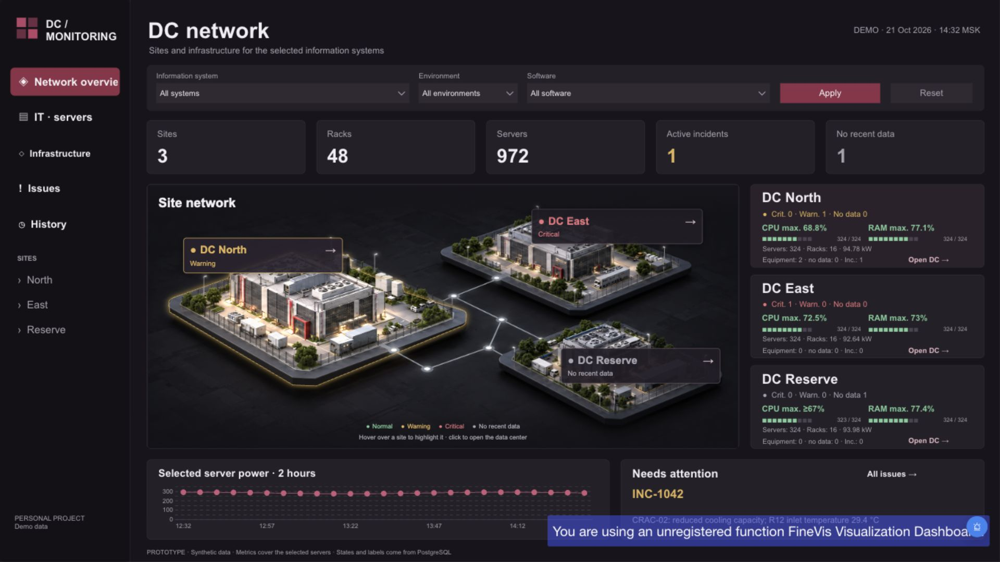
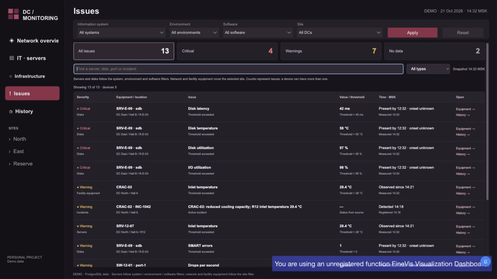

# User guide

The five pages share a fixed snapshot: **21 October 2026, 14:32 MSK**. All labels, issue times and chart windows refer to this snapshot, irrespective of today's date or browser clock. The demonstration is read-only.

## Shared filters and navigation

System, environment (`PROD`, `TEST`, `DEV`), software and site selectors intersect. Their `All` values mean unrestricted selection, not SQL NULL measurements. Server selection and pagination belong to the IT page; Infrastructure selection belongs to its physical drilldown; History has its own device selector. A new scope may exclude a previously selected server.

Server scope follows application/hosting paths and effective physical placement. Network and facility equipment on Issues/History cover the selected site independently of the application filters. A software filter therefore reduces server results while keeping site equipment visible. Reset the shared filters to `All` when reproducing the unfiltered totals.

Text and state labels accompany color: green Healthy, amber Warning, red Critical, gray No recent data, blue Maintenance. Gray unused rack space and a site with No matches are separate from missing readings. A percentage of zero is a real reading; an em dash or No data is unavailable telemetry.

## Page 1: DC network

Start with the global server, rack, site and active-incident totals. The site cards summarize selected servers and physical support-equipment health. CPU/RAM values are maxima of known readings, not average utilization. A `≥` marker means partial coverage: the known maximum is a lower bound for the whole selected population. Site power in kW is suppressed if even one selected server lacks a valid reading.

Open a site to reach its physical infrastructure. Review equipment issues separately from server issue counts. The power chart covers two hours at five-minute steps; gaps mean incomplete coverage. The incident card shows a representative latest active incident, while its count deduplicates incident IDs.

## Page 2: IT · servers

Use system/environment/software filters to identify physical servers supporting a business context. The summary separates healthy servers, servers whose reported status needs attention, servers with unknown status or unavailable metrics, and distinct related incidents. These categories can overlap: an otherwise healthy server can still have missing measurements.

The server table shows ten rows per page, sorted by reported attention priority then stable server key. Page requests beyond the end clamp to the last page. Choose a server to see hardware, site/hall/rack/U placement, CPU/RAM/inlet temperature, disk indicators, freshness, associated systems, software and related incidents. The CPU chart covers the last 30 minutes at five-minute steps.

Automatic selection chooses the first ranked matching server. A requested server outside the filter scope also falls back to that first matching server; an empty scope displays a No server card. Software rows describe installations on the chosen execution path, including host instances, rather than asserting every installation is used by every application. Use the Infrastructure link to open the selected server's rack and preserve context.

## Page 3: Infrastructure

Drill down from the network to a site, hall, rack and server or switch. Breadcrumbs and back controls return to parent levels. The illustrations provide context; clickable overlays, rack-U positions, equipment counts and measurements are generated from database inventory. The illustration's cabinet count is not the inventory count.

A rack displays physically occupied units even when application filters exclude some installed servers. Filtered server totals and physical occupancy have different meanings. Room equipment includes cooling and other floor equipment outside racks.

Entering a rack retains a manually selected server when possible; otherwise selection prioritizes critical state, attention, missing data, maintenance, then known CPU/RAM load and stable physical/identity tie-breakers. The selection reason is shown. Server detail exposes two disk components with usage, temperature and I/O telemetry. Switch detail exposes ports, link status, utilization, receive/transmit traffic, errors and drops. A connected port reported down is critical; an unused unconnected down port is not automatically an incident.

Equipment and component links open related History or IT context. A link from Issues may focus a disk, port or facility device directly. Floor equipment is focused in its room rather than fabricated as a rack-mounted server.

## Page 4: Issues

The queue lists problematic metric series, a fallback equipment-state problem when that device has no metric problem, and one row per active incident. A device may contribute several rows. The initial full fixture has **13 issues (4 critical, 7 warning, 2 unknown), on 5 devices, including 1 active incident**. The 13 rows must not be described as 13 failed servers or 13 incidents.

Use the local severity/category filters and text search to narrow already-loaded rows. Search matches identity, location, component, title and reason. These controls do not change the database or re-run application scope. Compare the row's value, unit, threshold and reason, then open Equipment for spatial context or History for the exact metric/component.

`Observed since` is an estimate within the two-hour source window. `Present by … · onset unknown` means the issue already existed without a known last-good point in that window. `Data missing since` can derive from an observation plus its freshness budget. None proves an exact physical fault onset.

## Page 5: History

Choose a device from the scope-aware report selector, then a component in the local view: whole device, disk or switch port. Select 30 minutes, 60 minutes or two hours. These local periods crop the same 25-point, two-hour payload; they do not fetch new observations. The default display period is 60 minutes.

Charts show source units, warning/critical thresholds, available sample statistics, observed state changes and relevant incident times. Missing, stale, error or invalid samples appear as gaps. Statistics use known points only. A series selected through an issue link is highlighted; all device series remain available. Connected-port link status uses 1=up and 0=down.

An explicitly selected device outside the current eligible scope yields No matching device rather than silently substituting another device. Clear the selection or reset the excluding filters to recover. Incident overlays represent detected times and related events within the bounded context, not continuous proof of application downtime.

For reproducible examples, follow the [walkthrough](demo-walkthrough.md). For a blank or incorrect view, consult [troubleshooting](troubleshooting.md).
